
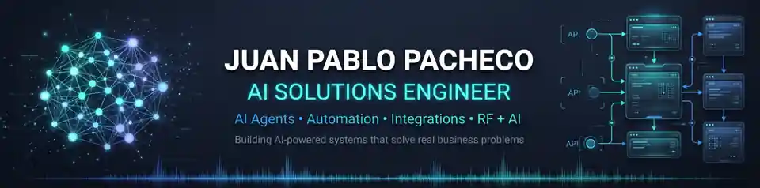

               

  

I turn customer and operational problems into AI integrations, automation, and working tools. My focus is **AI solutions engineering**: understand the workflow, design the solution, build with AI coding agents, test it, and own its operation. I also build **RF + AI** software: software-defined radio apps with on-device machine learning for drone detection, GPS interference, SCADA radio links, spectrum monitoring and signal classification.

At [JoGo.Team](https://jogo.team), I build AI capabilities for a sports marketplace. My background in customer success, technical sales, and radio systems helps me connect business needs with implementation and explain the tradeoffs to the people using it.

**Open to remote AI Solutions Engineer, AI Solutions Implementation, and AI Automation roles.** See my portfolio at [jeyp.net](https://www.jeyp.net) or [connect on LinkedIn](https://www.linkedin.com/in/jeypnet/).

<picture><source media="(prefers-color-scheme: dark)" srcset="assets/divider-dark.svg"><source media="(prefers-color-scheme: light)" srcset="assets/divider-light.svg"></picture>

## Start here: problems I solve

<table><tr><td width="33%" align="center"><a href="https://github.com/jeypnet/csm-account-intelligence"><picture><source media="(prefers-color-scheme: dark)" srcset="assets/portfolio-v2/account-intelligence-dark.svg"><source media="(prefers-color-scheme: light)" srcset="assets/portfolio-v2/account-intelligence-light.svg">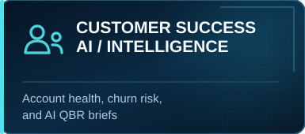</picture></a></td>
<td width="33%" align="center"><a href="https://github.com/jeypnet/twilio-whatsapp-reengagement"><picture><source media="(prefers-color-scheme: dark)" srcset="assets/portfolio-v2/reengagement-dark.svg"><source media="(prefers-color-scheme: light)" srcset="assets/portfolio-v2/reengagement-light.svg">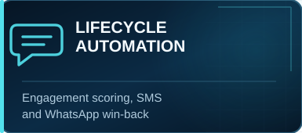</picture></a></td>
<td width="33%" align="center"><a href="https://github.com/jeypnet/Quest-Demos"><picture><source media="(prefers-color-scheme: dark)" srcset="assets/portfolio-v2/sales-engineering-dark.svg"><source media="(prefers-color-scheme: light)" srcset="assets/portfolio-v2/sales-engineering-light.svg">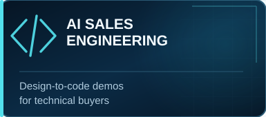</picture></a></td></tr></table>

<table>
<tr>
<td width="33%"> <b>Customer success AI</b> Account health, churn risk, AI QBR briefs</td>
<td width="33%"> <b>Lifecycle marketing automation</b> Engagement scoring, SMS and WhatsApp win-back</td>
<td width="33%"> <b>AI sales engineering</b> Design-to-code demo for technical buyers</td>
</tr>
</table>

| Area | Project and evidence | What it demonstrates |
|---|---|---|
| AI + sports marketplace | [JoGo MCP case study](case-studies/jogo-mcp.md) | Connecting assistants to a real platform through structured tools |
| Customer operations + SaaS | [Account intelligence](https://github.com/jeypnet/csm-account-intelligence) · [sample report](https://github.com/jeypnet/csm-account-intelligence/blob/main/A002_Cascade_Logistics_HealthReport.pdf) | Risk prioritization, optional LLM briefs, and customer-facing reporting using synthetic accounts |
| Retention + lifecycle automation | [SMS / WhatsApp re-engagement](https://github.com/jeypnet/twilio-whatsapp-reengagement) | Engagement scoring and channel selection, with a no-send demonstration |
| Radio + hardware integration | [SmartSDR client](https://github.com/jeypnet/flexradio-smartsdr-client) | Network discovery, device commands, and asynchronous status callbacks |
| Radio + external data | [HF propagation checker](https://github.com/jeypnet/hf-propagation-checker) | Translating space-weather inputs into an explainable band-scoring heuristic |
| AI products + technical demonstrations | [Quest demos](https://github.com/jeypnet/Quest-Demos) | Evaluating Figma-to-React output and explaining integration tradeoffs to technical buyers |

The repositories include demonstration code and technical utilities. Each README explains its scope and how to inspect it. Synthetic industry examples are not client references; employer experience does not imply deployment of these public projects at those employers or their customers.

<picture><source media="(prefers-color-scheme: dark)" srcset="assets/divider-dark.svg"><source media="(prefers-color-scheme: light)" srcset="assets/divider-light.svg"></picture>

## ✈ Flagship RF project: KG5ZZB SDR Airband Receiver

<a href="https://github.com/jeypnet/KG5ZZB-Radio-Apps"><picture><source media="(prefers-color-scheme: dark)" srcset="assets/portfolio-v2/flagship-dark.svg"><source media="(prefers-color-scheme: light)" srcset="assets/portfolio-v2/flagship-light.svg">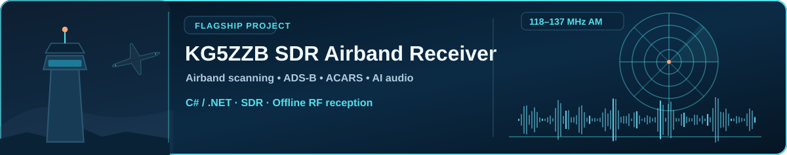</picture></a>

<a href="https://github.com/jeypnet/KG5ZZB-Radio-Apps">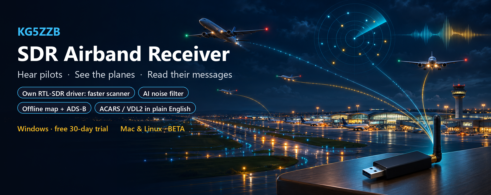</a>

A complete aviation radio app for a low-cost RTL-SDR dongle, built end to end in C# / .NET: **an airband scanner with an AI noise filter, a live map of the planes around you from their ADS-B transponders, and the ACARS / VDL2 messages they send, explained in plain English.** It runs offline, from your own antenna.

- **Own RTL-SDR driver** (USB, tuner and PLL control in C#): the scanner checks every channel [almost twice as often as with the free driver](https://github.com/jeypnet/KG5ZZB-Radio-Apps/blob/main/docs/airband-driver.md), with 1000 retunes in a row and no errors.
- **Own decoders**: ADS-B, ACARS and VDL Mode 2 (D8PSK, Reed–Solomon), all in the app.
- **AI noise filter** (RNNoise) for weak voices, and **plug and play with two receivers**: the app finds which one hears planes and gives it the map.
- RTL-SDR, SDRplay, Airspy and HackRF One (beta) receivers · Windows, Mac and Linux.

**[⬇ Download free (Windows)](https://github.com/jeypnet/KG5ZZB-Radio-Apps/releases/latest)** · **[Mac & Linux](https://github.com/jeypnet/KG5ZZB-Radio-Apps#-downloads-for-every-system)** · **[How it works and measured results](https://github.com/jeypnet/KG5ZZB-Radio-Apps)**

<picture><source media="(prefers-color-scheme: dark)" srcset="assets/divider-dark.svg"><source media="(prefers-color-scheme: light)" srcset="assets/divider-light.svg"></picture>

## RF + AI: software-defined radio projects

<table>
<tr><td width="50%" align="center"><a href="https://github.com/jeypnet/KG5ZZB-Drone-RF-Detector"><picture><source media="(prefers-color-scheme: dark)" srcset="assets/portfolio-v2/drone-dark.svg"><source media="(prefers-color-scheme: light)" srcset="assets/portfolio-v2/drone-light.svg">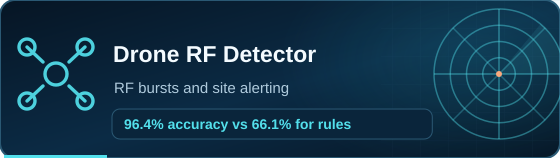</picture></a></td>
<td width="50%" align="center"><a href="https://github.com/jeypnet/KG5ZZB-GNSS-Interference-Monitor"><picture><source media="(prefers-color-scheme: dark)" srcset="assets/portfolio-v2/gnss-dark.svg"><source media="(prefers-color-scheme: light)" srcset="assets/portfolio-v2/gnss-light.svg">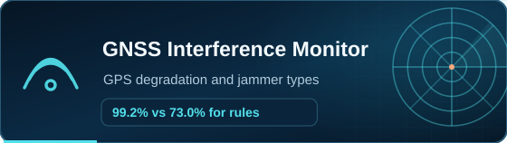</picture></a></td></tr>
<tr><td width="50%" align="center"><a href="https://github.com/jeypnet/KG5ZZB-SCADA-RF-Link-Monitor"><picture><source media="(prefers-color-scheme: dark)" srcset="assets/portfolio-v2/scada-dark.svg"><source media="(prefers-color-scheme: light)" srcset="assets/portfolio-v2/scada-light.svg">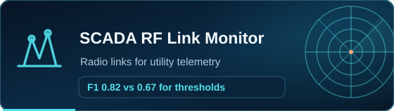</picture></a></td>
<td width="50%" align="center"><a href="https://github.com/jeypnet/KG5ZZB-RF-Signal-Classifier"><picture><source media="(prefers-color-scheme: dark)" srcset="assets/portfolio-v2/classifier-dark.svg"><source media="(prefers-color-scheme: light)" srcset="assets/portfolio-v2/classifier-light.svg">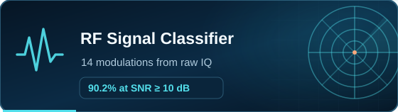</picture></a></td></tr>
<tr><td width="50%" align="center"><a href="https://github.com/jeypnet/KG5ZZB-Spectrum-Anomaly-Detector"><picture><source media="(prefers-color-scheme: dark)" srcset="assets/portfolio-v2/spectrum-dark.svg"><source media="(prefers-color-scheme: light)" srcset="assets/portfolio-v2/spectrum-light.svg">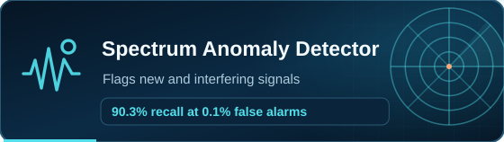</picture></a></td>
<td width="50%" align="center"><a href="https://github.com/jeypnet/KG5ZZB-IoT-RF-Inventory"><picture><source media="(prefers-color-scheme: dark)" srcset="assets/portfolio-v2/iot-dark.svg"><source media="(prefers-color-scheme: light)" srcset="assets/portfolio-v2/iot-light.svg">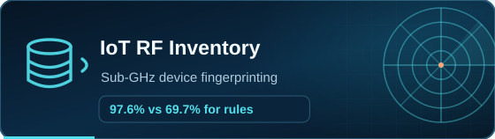</picture></a></td></tr>
</table>

Windows apps that turn a low-cost RTL-SDR into a sensor, with **machine learning trained in PyTorch and run on-device with ONNX Runtime** in C# / .NET. Each one is receive-only and ships with a model card that reports measured results against a classical baseline.

<table>
<tr>
<td width="50%"></td>
<td width="50%"></td>
</tr>
<tr>
<td></td>
<td></td>
</tr>
<tr>
<td></td>
<td></td>
</tr>
</table>

| Project | Industry | What it does | Measured result |
|---|---|---|---|
| [Drone RF Detector](https://github.com/jeypnet/KG5ZZB-Drone-RF-Detector) | Counter-UAS, critical infrastructure | Neural network classifies 900 MHz RF bursts; frequency-hopping and site-baseline alert logic; FAA Remote ID (ASTM F3411) over Bluetooth | 96.4% accuracy vs 66.1% for rules |
| [GNSS Interference Monitor](https://github.com/jeypnet/KG5ZZB-GNSS-Interference-Monitor) | Aviation, PNT, defense | Maps GPS degradation from ADS-B NACp/NIC, estimates the jammer location, CNN classifies GPS L1 jammer types | 99.2% vs 73.0% for rules |
| [SCADA RF Link Monitor](https://github.com/jeypnet/KG5ZZB-SCADA-RF-Link-Monitor) | Energy, oil & gas, utilities (OT) | Radio link health for RTU telemetry; autoencoder anomaly detection; MQTT and Modbus TCP outputs for SCADA/Ignition | F1 0.82 vs 0.67 for thresholds |
| [RF Signal Classifier](https://github.com/jeypnet/KG5ZZB-RF-Signal-Classifier) | RF machine learning, spectrum | 1-D CNN names 14 modulations from raw IQ; Python/C# preprocessing parity; SigMF recording | 90.2% at SNR ≥ 10 dB |
| [Spectrum Anomaly Detector](https://github.com/jeypnet/KG5ZZB-Spectrum-Anomaly-Detector) | Spectrum monitoring, telecom | Time-of-day baseline + autoencoder flag new, missing and interfering signals from 24 MHz to 1.7 GHz | 90.3% recall at 0.1% false alarms |
| [IoT RF Inventory](https://github.com/jeypnet/KG5ZZB-IoT-RF-Inventory) | IoT, physical/RF security | Demodulates OOK/FSK sub-GHz devices, classifies modulation, DBSCAN fingerprinting, new-device alerts | 97.6% vs 69.7% for rules |

The RF + AI repositories are project showcases (description, results, model card); the source code is private and technical walkthroughs are available on request.

<picture><source media="(prefers-color-scheme: dark)" srcset="assets/divider-dark.svg"><source media="(prefers-color-scheme: light)" srcset="assets/divider-light.svg"></picture>

## How I build

<picture><source media="(prefers-color-scheme: dark)" srcset="assets/portfolio-v2/build-dark.svg"><source media="(prefers-color-scheme: light)" srcset="assets/portfolio-v2/build-light.svg">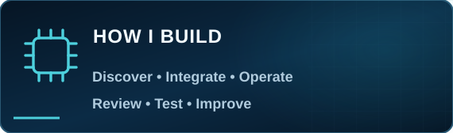</picture>

I use an AI-native development process. AI coding agents help produce the code; I own the problem definition, solution design, review, testing, troubleshooting, and completed workflow. Quest's repository explicitly identifies its generated platform output.

- **Discover and explain:** connect customer requirements to a practical workflow, demonstrate the result, and discuss limitations.
- **Integrate:** work with MCP, REST APIs, webhooks, messaging services, and operational data.
- **Operate and improve:** investigate failures, evaluate fallback behavior, and use customer feedback and analytics to guide the next change.

Tools across my work include Claude Code, MCP, PyTorch, ONNX Runtime, C# / .NET (WPF), DSP and RTL-SDR, Anthropic and OpenAI APIs, Python/Django, Twilio, Stripe Connect, SendGrid, Cloudflare, GitHub Actions, Sentry, GA4, and Google Search Console. The projects above show specific slices of that work, not a claim that every tool is implemented in every repository.

<picture><source media="(prefers-color-scheme: dark)" srcset="assets/divider-dark.svg"><source media="(prefers-color-scheme: light)" srcset="assets/divider-light.svg"></picture>

## Industry experience behind the projects

<picture><source media="(prefers-color-scheme: dark)" srcset="assets/portfolio-v2/experience-dark.svg"><source media="(prefers-color-scheme: light)" srcset="assets/portfolio-v2/experience-light.svg">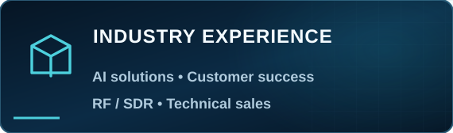</picture>

- **JoGo.Team:** customer operations and AI integration for a sports marketplace.
- **BP3 Global:** enterprise AI and automation sales across banking and manufacturing.
- **Konica Minolta:** public-sector accounts, document workflows, and AI security platforms.
- **FlexRadio Systems:** customer-facing work with software-defined radio across defense, utilities, and emergency response.
- **Quest:** demonstrations of an AI design-to-code product for enterprise buyers.
- **Motorola BGH:** hands-on radio and electronics support.

Engineering education at UTN FRBA, Extra Class amateur radio background, and bilingual English / Spanish communication inform how I approach technical problems.

[LinkedIn](https://www.linkedin.com/in/jeypnet/) · [Browse the projects](https://github.com/jeypnet?tab=repositories)
